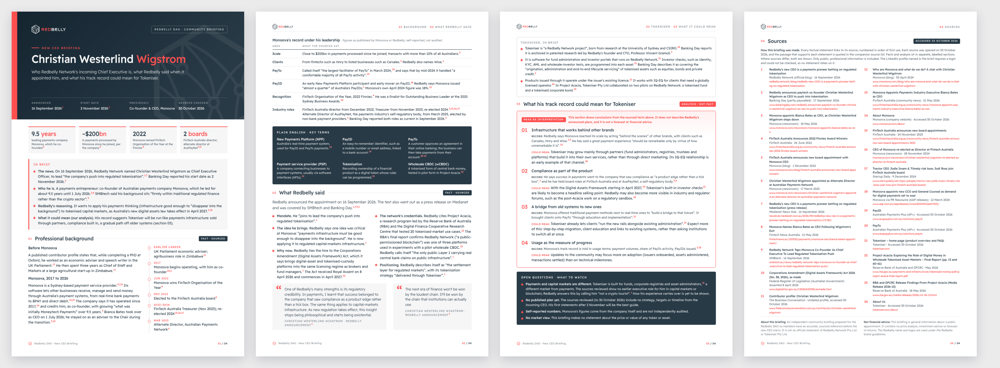

<p align="center">
  
</p>

<h1 align="center">New CEO Briefing: Christian Westerlind Wigstrom</h1>

<p align="center">
  A short, fully sourced briefing for the Redbelly DAO on Redbelly Network's incoming Chief Executive,<br>
  and what his track record could mean for Tokeniser.
</p>

<p align="center">
  
  
  
  
  
</p>

<p align="center">
  
</p>

---

## Overview

Redbelly Network announced on 16 September 2026 that Christian Westerlind Wigstrom will become its Chief Executive Officer, starting in November 2026. The community is already asking who he is and what the appointment means for the network.

This repository holds a neutral, sourced reference the DAO can share before he starts. It covers his professional background from the public record, what Redbelly said when it announced the appointment, and a clearly labelled analysis of what his track record could mean for Tokeniser. Every factual statement links to a public source, and every source has been checked against the exact passage it is cited for.

## Deliverables

| # | Deliverable | File | Format |
|---|-------------|------|--------|
| 1 | **Briefing.** Three pages of briefing plus a one-page source appendix, in the Redbelly brand system | [`deliverables/01-ceo-briefing.pdf`](deliverables/01-ceo-briefing.pdf) | A4 PDF, 4 pages, clickable source links |
| 2 | **X thread.** 8 ready-to-post posts, each within 280 characters | [`deliverables/02-x-thread.md`](deliverables/02-x-thread.md) | Markdown (copy and paste) |
| | Print preview of the thread, with character counts per post | [`deliverables/02-x-thread.pdf`](deliverables/02-x-thread.pdf) | PDF |
| | Header image for post 1 (alt text included in the thread file) | [`deliverables/02-x-thread-card.png`](deliverables/02-x-thread-card.png) | PNG, 1600 × 900 |
| 3 | **Source list.** All 24 sources, each with the statements it supports and the verbatim passage that supports them | [`deliverables/03-source-list.md`](deliverables/03-source-list.md) | Markdown |
| | Same source list, typeset | [`deliverables/03-source-list.pdf`](deliverables/03-source-list.pdf) | PDF |

Source numbers are the same in all three deliverables.

## What the briefing covers

| Section | Type | Contents |
|---------|------|----------|
| In brief | Summary | The appointment, who he is, Redbelly's reasoning, and a one-line pointer to the analysis |
| 01 · Professional background | Fact | Earlier career; co-founding and leading Monoova (2017 to 2026); Monoova's reported record on scale, clients, PayTo, PayID and awards; board roles at FinTech Australia and the Australian Payments Network; plain-English glossary of payments terms |
| 02 · What Redbelly said | Fact | The mandate, the "infrastructure that disappears" idea, the Digital Assets Framework Act timing, Project Acacia (checked against the Reserve Bank of Australia's final report), his two published quotes, and Tokeniser in brief |
| 03 · What it could mean for Tokeniser | Analysis | Four themes, each set out as *Record* (sourced) and *Could mean* (interpretation), followed by open questions to watch |
| 04 · Sources | Reference | Numbered source list, method note and disclaimer |

## Editorial standards

The brief's quality benchmarks and failure criteria are built into how the content is written and checked.

- **Every factual claim is sourced.** Each statement carries a numbered, clickable link. The source list quotes the exact passage that supports it, and `npm run verify` confirms that passage is on the live page.
- **Facts and analysis are kept apart.** Sections 01 and 02 are marked *Fact · sourced*. Section 03 is marked *Analysis · not fact*, sits in a separate outlined panel, and opens by saying it is interpretation, not Redbelly's announced plans.
- **Primary sources first.** Redbelly, Monoova, Tokeniser, the Reserve Bank of Australia, the Federal Register of Legislation, Australian Payments Plus and FinTech Australia are used wherever possible. Independent media (Banking Day, SMBtech, Fintech News Australia, Startup Daily) corroborate them.
- **Disagreements are shown, not smoothed over.** For example, Redbelly says Monoova issued "almost a quarter" of Australia's PayIDs, while Monoova's own April 2024 figure was 18%. Both appear, each with its source.
- **Self-reported figures are labelled** as self-reported and not independently audited.
- **Quotes are verbatim.** Only quotes published by the sources are used, and the verifier checks each one sentence by sentence against the live source.
- **Professional record only.** No private or family information is included, even where a source mentions it.
- **No price talk.** There is no token price discussion, investment advice or forecast of returns.
- **No personal credit.** The deliverables carry no names, handles, signatures or "made by" lines.
- **Plain language.** The briefing is written for readers new to both the person and payments, and payments terms are explained in a glossary.

## Verification

`npm run verify` checks the deliverables against their sources and the brief's rules, then writes [`verification/verification-report.md`](verification/verification-report.md).

| Check | What it does |
|-------|--------------|
| Citations resolve | Every citation marker in the briefing points to a source in [`data/sources.json`](data/sources.json), and every listed source is cited |
| Source links | Every source URL is fetched live and must return HTTP 2xx |
| Supporting passages | All 69 recorded passages must appear on the live page (PDFs are read with `pdftotext`) |
| Quotations | Every block quote and quoted phrase in the briefing and thread must appear verbatim in a source |
| Thread | 5 to 8 posts, each within 280 characters under X's counting rules (each link counts as 23), and every link in the thread is a listed source |
| Guardrails | All deliverables are scanned for personal credit, social handles, price or investment language, and private-life terms |

The build checks layout too: it fails if any page of the briefing overflows, and if the Readex Pro brand typeface does not load.

Latest run (30 October 2026): **all checks pass.** 24 of 24 links are live, 69 of 69 passages were found, all 28 quotations match, and the longest thread post is 278 of 280 characters.

## Brand compliance

The deliverables follow the public [Redbelly brand guidelines](https://redbelly.network/brand).

| Element | Usage |
|---------|-------|
| Main colours | Red `#FF5050` and grey `#283A46` |
| Secondary colours | `#FA423C`, `#142530`, `#848B91`, `#D9D9D9` and `#ECEBEC`, for hierarchy, rules and panels |
| Typeface | **Readex Pro**: Medium for headers and subheaders, Regular and Light for body text, colours as specified by the guidelines |
| Logos | Official horizontal logo (primary and negative) and isotype, taken unaltered from Redbelly's brand pack and website |
| Layout cues | Navy gradient cover with a red edge bar, red-underlined section labels and the isotype motif, as in the guideline application examples |

## Repository structure

```text
.
├── deliverables/            Final outputs (what the DAO publishes)
│   ├── 01-ceo-briefing.pdf
│   ├── 02-x-thread.md / .pdf / -card.png
│   └── 03-source-list.md / .pdf
├── data/
│   ├── sources.json         Single source of truth: every source, the statements it supports, verbatim passages
│   └── x-thread.json        Thread posts and the sources behind each
├── source/
│   ├── briefing.html        Briefing template; [[source-key]] markers become numbered links at build time
│   ├── styles/brand.css     Redbelly brand system (colours, type, components)
│   └── assets/              Official logos and Readex Pro (SIL Open Font License)
├── scripts/
│   ├── build.mjs            Renders every deliverable with headless Chromium
│   ├── site.mjs             Assembles the hosted web page from the committed deliverables (no browser needed)
│   ├── verify.mjs           Live source, quote, thread and guardrail checks
│   └── lib.mjs              Shared helpers
├── verification/
│   └── verification-report.md
├── docs/
│   └── briefing-preview.png
└── vercel.json              Hosting config: runs build:site and serves public/
```

## Rebuilding

**Requirements:** Node.js 20 or later, `curl`, and `pdftotext` (Poppler) for verification.

```bash
npm install
```

```bash
npx playwright install chromium
```

```bash
npm run build
```

```bash
npm run verify
```

`npm run check` runs the build and then the verification. `npm run verify:offline` runs only the checks that need no network.

| Script | What it does | Needs Chromium |
|--------|--------------|----------------|
| `npm run build` | Renders all PDFs, the thread card and the README preview into `deliverables/` and `docs/` | Yes |
| `npm run build:site` | Assembles the web page in `public/` from the committed deliverables | No |
| `npm run verify` | Runs every check and writes the verification report | No (needs `curl` and `pdftotext`) |

### Editing content

1. Edit the text in `source/briefing.html`. Cite with `[[source-key]]` or `[[key-one,key-two]]`. Numbers are assigned automatically in order of first use.
2. To add a source, add an entry to `data/sources.json` with its URL and at least one `{ claim, excerpt }` pair, where the excerpt is copied exactly from the page.
3. Run `npm run check`. The build stops if a page overflows, and verification fails if a passage or quote cannot be found on the live source.

## Hosting on Vercel

The repository deploys to Vercel as a static site with no extra settings. [`vercel.json`](vercel.json) tells Vercel to:

- skip development dependencies (`npm install --omit=dev`), so Playwright is not installed;
- run `npm run build:site`, which publishes the committed files in `deliverables/` with a branded index page;
- serve the result from `public/`.

The index page links the briefing PDF, shows the eight thread posts with copy buttons and character counts, summarises the verification results, and lists the sources in briefing order. Vercel's build machines have no Chromium, so the PDFs are never re-rendered there. After editing content, run `npm run build` locally and commit the updated `deliverables/` before deploying.

## Posting the thread

1. Publish `deliverables/01-ceo-briefing.pdf` wherever the DAO hosts documents, or use the Vercel deployment at `/deliverables/01-ceo-briefing.pdf`.
2. Open `deliverables/02-x-thread.md` and replace `{BRIEFING_LINK}` in post 8 with that address.
3. Attach `deliverables/02-x-thread-card.png` to post 1, using the alt text given in the file.
4. Post the eight posts in order as a single thread.

## Notes and limitations

- **Point in time.** Sources were checked on 30 October 2026, before the new CEO's 2 November 2026 start date. Web pages can change; re-run `npm run verify` before republishing.
- **LinkedIn.** The public profile listed in the brief sits behind a login wall and cannot be read automatically. It is listed under "Also consulted", and no statement relies on it.
- **Banking Day** is partly paywalled. Only the freely available part of the article is cited.
- **Legislation.** The Federal Register of Legislation loads the Act's text in an embedded frame. Readers get the official page link; the verifier reads the embedded document, recorded as `verifyUrl` in `data/sources.json`.
- **Company figures** from Monoova, Redbelly and Tokeniser are self-reported and have not been independently audited.

## Rights and disclaimer

- This is an independent community briefing prepared for the Redbelly DAO. It is not an official statement of Redbelly Network Pty Ltd, Tokeniser Pty Ltd or Monoova.
- The Redbelly name and logos belong to Redbelly Network and are used under its public brand guidelines.
- Readex Pro is licensed under the SIL Open Font License 1.1 (see [`source/assets/fonts/OFL.txt`](source/assets/fonts/OFL.txt)).
- Quoted material remains the property of its publishers and is quoted for reference and verification.
- **Not financial advice.** Nothing here is a recommendation to buy, sell or hold any token or asset.
